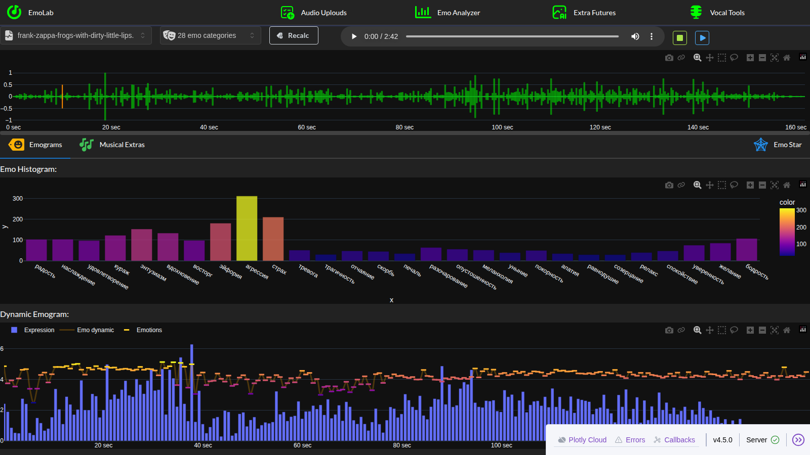
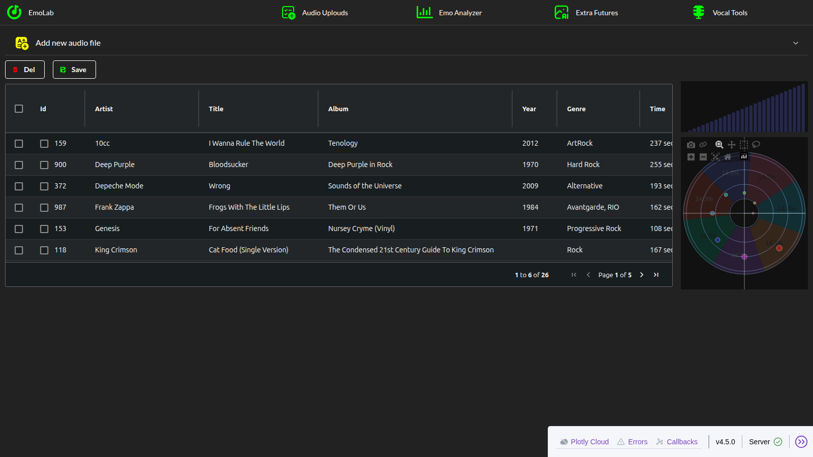
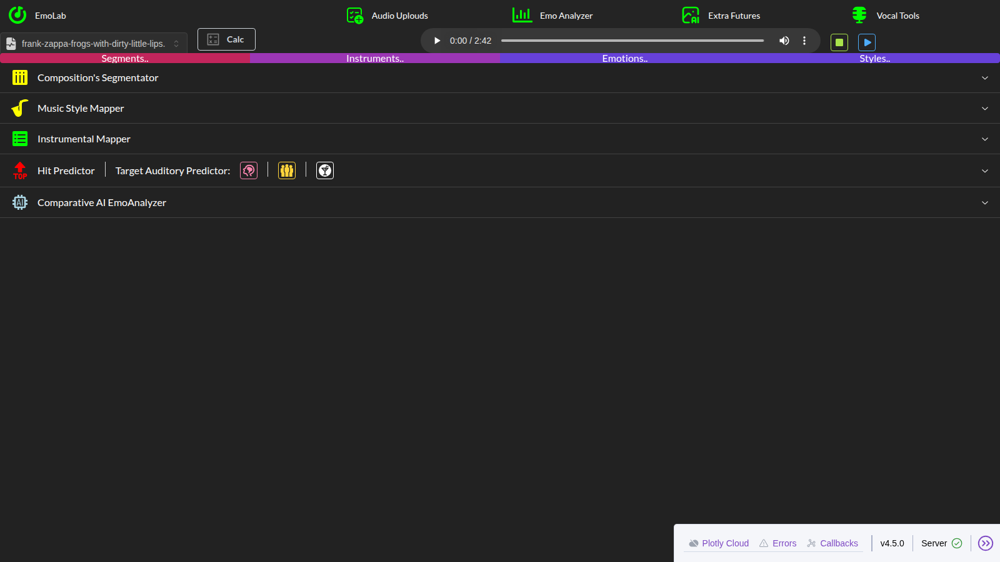

# EmoLab

Веб-лаборатория эмоционального анализа музыки: трек загружается в коллекцию,
прогоняется через аудио- и эмо-анализаторы (essentia + tensorflow-модели), а
результаты показываются интерактивными графиками plotly — эмограммой, «эмо-звездой»,
облаком эмоций, картами сегментов/стилей/инструментов. Отдельный набор инструментов
разделяет трек на вокал/бас/ударные/аккомпанемент (Spleeter) и анализирует реверберацию и питч вокала.

## Скриншоты

| Emo Analyzer | Коллекция | Extras |
|---|---|---|
|  |  |  |

## Страницы

| Путь | Назначение |
|---|---|
| `/` | Заставка EmoLab |
| `/uploads` | Загрузчик аудио (chunked-upload), таблица коллекции (AG Grid: правка ячеек, удаление строк, сохранение CSV), степпер авто-анализа нового трека |
| `/analyze` | Аудиоплеер + синхронные графики: волна, аккорды, темп, танцевальность, RMS; вкладки Emograms / Musical Extras / Emo Star |
| `/extras` | Сегментатор композиции (librosa), карты стилей и инструментов, hit-предиктор, сравнительный эмо-анализ |
| `/tools` | Vocal Tools: сплиттер вокала (Spleeter 2/4 дорожки), реверб/pitch-анализ вокала, балансы вокал/инструментал |

## Стек

- Python **3.11**, GPU CUDA 11 (tensorflow 2.14; CUDA-библиотеки ставятся pip-пакетами `nvidia-*-cu11`)
- **dash 4.5** + **dash-mantine-components 2.8.1** (Mantine 8, тёмная тема) + **plotly 7.1**
- **dash-ag-grid 35** (таблица коллекции), dash-uploader (chunked-загрузка), dash-player, dash-iconify
- **essentia / essentia-tensorflow** (аудио-дескрипторы и нейроклассификаторы), **librosa**, **scikit-learn**, pandas/numpy
- Flask 3.1 / Werkzeug 3.1 как сервер dash

## Установка

```bash
git clone https://github.com/alexkuz60/emolab-ai.git
cd emolab-ai
python3.11 -m venv .venv
.venv/bin/pip install -r requirements.txt
```

### Модели и аудио не входят в репозиторий

Каталоги `models/` и `audio/` исключены из git (крупные бинарники и лицензионные mp3)
и создаются локально:

- `audio/` — ваши треки (wav/mp3); это же рабочая папка загрузчика страницы `/uploads`;
- `models/` — нейровеса, которые код ждёт по фиксированным путям:
  - классификаторы essentia-tensorflow (`discogs-effnet-bs64-1.pb`, `mood_*`, `mtg_jamendo_*`,
    `nsynth_*`, `voice_instrumental-*` и др.) — <https://essentia.upf.edu/models.html>;
  - веса Spleeter `spleeter-2s-3.pb`, `spleeter-4s-3.pb`, `spleeter-5s-3.pb` —
    релизы <https://github.com/deezer/spleeter>;
  - `hdemucs_high_trained.pt` — задел под будущие сплиттеры.

Без `models/` страницы `/extras` и `/tools` не смогут считать анализ; `/uploads` и `/analyze`
работают и на пустой коллекции.

## Запуск

```bash
./run.sh
```

Скрипт выставляет `LD_LIBRARY_PATH` на `nvidia/*/lib` из `.venv` (essentia-tensorflow ищет
CUDA-библиотеки только там) и стартует `emo_app.py`. Приложение открывается на
<http://127.0.0.1:8050/>.

Для Vocal Tools (`/tools`) создайте каталог `temps/` — туда сплиттер пишет промежуточные wav:

```bash
mkdir -p temps
```

## Структура

```
emo_app.py            точка входа: Dash app, AppShell-шапка, pages
pages/                страницы dash-pages: home, uploads, analyze, extras, tools
libs/                 emolib (эмо-анализ), extraslib (сегментер/карты), toolslib (сплиттер),
                      emocomp/emofunc (общие компоненты и фигуры), emolist (словари эмоций)
datas/  extras/       кэши готовых фигур (.npy) по каждому треку коллекции
assets/               style.css, piano_keys.png, скриншоты
models/  audio/       локальные данные (в git не входят)
migrate_npy_plotly.py одноразовая миграция .npy-кэшей с plotly 5 на plotly 7
run.sh                запуск с GPU
```

## Кэши фигур и миграция plotly 7

`datas/*.npy` и `extras/*.npy` — пиклы готовых plotly-фигур по каждому треку: страницы
открываются мгновенно, пересчёт запускается кнопками Recalc/Calc. Фигуры, сохранённые
plotly 5, под plotly 7 не читаются (из шаблона `plotly_dark` удалены трейсы
`heatmapgl`/`pointcloud`) — для них есть идемпотентный скрипт:

```bash
.venv/bin/python migrate_npy_plotly.py --check   # показать, что нужно мигрировать
.venv/bin/python migrate_npy_plotly.py --apply   # мигрировать
```

## Замечания по зависимостям

- `packaging==21.3` и `setuptools<81` в `requirements.txt` — осознанные пины: dash-uploader
  0.7.0a1 использует `packaging.version.LegacyVersion` и `pkg_resources`.
- dash-mantine-components намеренно остановлен на 2.8.1: версия 3.0 требует React 19,
  поддержка которого в dash 4.5 помечена экспериментальной.
